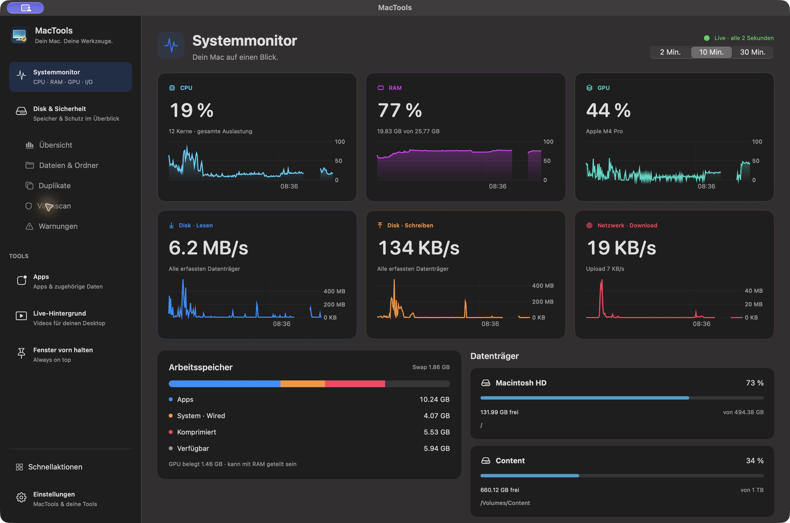
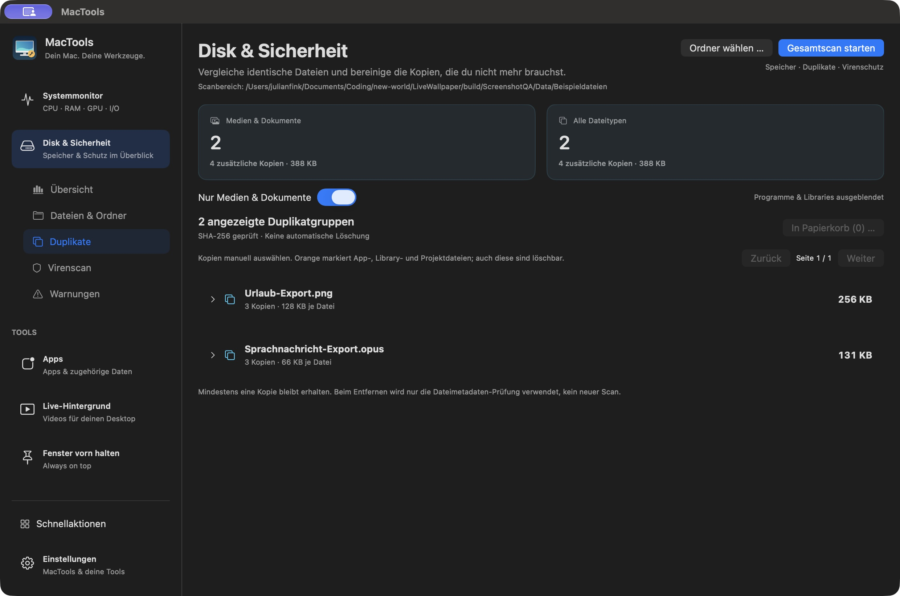

# MacTools

Dein Mac. Deine Werkzeuge. Eine native macOS-App von **[Julian Fink](https://julian.fink-cloud.net)**, gebaut mit Swift, SwiftUI und AppKit.

[MacTools herunterladen](https://github.com/JulianFink01/mac-tools/releases/latest/download/MacTools-universal.dmg) · [Alle Releases](https://github.com/JulianFink01/mac-tools/releases) · [Meine Website](https://julian.fink-cloud.net)

macOS 13 oder neuer · Universal Binary für Apple Silicon und Intel · lokale Verarbeitung

## Systemmonitor und Menüleiste



Die Startansicht zeigt echte Messwerte für CPU, RAM, GPU, Datenträger und Netzwerk. Karten mit Verlauf führen zu Detailansichten: CPU-Kerne, Speicherdruck, Apps/Wired/komprimierter RAM, Swap und Top-Prozesse. Messwerte werden alle zwei Sekunden aktualisiert; Verläufe bleiben lokal gespeichert. GPU-Daten erscheinen nur, wenn macOS sie bereitstellt.

CPU-, RAM-, GPU- und Disk-Widgets lassen sich in den Einstellungen einzeln aktivieren. Das Schnellpanel bietet aktuelle Werte, Speicherbelegung und Schnellaktionen. Priorisierte Live-Ereignisse – Funde, laufende Scans und angeheftete Fenster – stehen oben; zwischen Ereignissen kann man wischen oder mit Pfeilen wechseln. Angeheftete Fenster lassen sich einzeln lösen.


Die Duplikat-Abbildung verwendet eigene Beispieldateien.

## Disk & Sicherheit

Ein Gesamtscan erfasst den ausgewählten Ordner oder das Volume ohne feste Dateigrenze und verbindet Speicheranalyse, Duplikatprüfung und anschließende Virenprüfung. Die Dateiliste ist schon während der Inhaltsprüfung nutzbar.

- Ordner öffnen über die gesamte Zeile, Breadcrumbs, aktueller Pfad, Zurück/Vorwärts und eine Ebene höher.
- Große Dateien, Dateitypen, Ordnergrößen, Dateizahlen und Verlauf abgeschlossener Scans.
- Logische Größe, tatsächlich gemeldete Dateibelegung und freier Volume-Speicher werden getrennt dargestellt. Sparse-Dateien und APFS-Kopien können deutlich weniger Platz belegen als ihre logische Größe.
- Persistente Ergebnisse einschließlich Dateilisten, Ordnern und Duplikaten. Große Berichte werden atomar in Blöcken gespeichert und nach Neustart im Hintergrund geladen.
- Fortschritt unten in der Seitenleiste und im Schnellpanel. Zugriffshinweise stehen nur in der Übersicht; geänderte laufende Datenbanken und Cloud-Platzhalter sind neutrale Scan-Informationen.

### Duplikate bewusst auswählen



Standardmäßig zeigt der Filter Bilder, GIFs, Videos, Audio, PDFs, Office-Dateien und CSV. Der Filter lässt sich ausschalten; getrennte Zähler zeigen Medien/Dokumente und alle Dateitypen.

Die Erkennung prüft Dateigröße, liest bei großen Dateien zunächst Ausschnitte und bestätigt Übereinstimmungen mit vollständigem SHA-256. Bis zu vier begrenzte Arbeiter und ein Cache für unveränderte Dateien beschleunigen weitere Scans. Der Cache berücksichtigt Dateiidentität, Größe sowie Änderungszeiten inklusive ctime. Hardlinks zählen einmal; Symlinks werden nicht verfolgt und Cloud-Dateien werden für die Inhaltsprüfung nicht automatisch heruntergeladen.

Dateien lassen sich vergleichen und **nur nach ausdrücklicher Auswahl und Bestätigung** in den Papierkorb verschieben. Auch App-, Library-, Projekt- und WhatsApp-Dateien sind manuell auswählbar. Heikle Pfade sind orange markiert; der Löschdialog erläutert mögliche Folgen. „Alle Kopien dieser Gruppe auswählen“ wählt auch große Gruppen gesammelt aus. Mindestens eine Kopie bleibt erhalten. **Keine automatische Bereinigung.** Beim Entfernen werden Dateimetadaten kontrolliert; danach werden nur die tatsächlich entfernten Einträge und ihre Statistiken aktualisiert und gespeichert. Es folgt kein automatischer Neu- oder Virenscan. Löschungen werden zentral an Dateilisten, Duplikate und Virenfunde weitergegeben; auch entfernte App-Daten werden berücksichtigt.

### Lokaler Virenscan

ClamAV-Engine, Bibliotheken und initiale Signaturen gehören zum Anwendungspaket; Homebrew ist für die Benutzung nicht erforderlich. Schutzdaten lassen sich aktualisieren. Der tägliche Gesamtscan führt Speicher-, Duplikat- und Virenprüfung gemeinsam aus. Warnkarten beschränken sich auf Funde, fehlgeschlagene Prüfungen, Signaturprobleme und akut knappen Speicher; einzelne ausgelassene Dateien stehen im Scan-Ergebnis.

Die Virenprüfung nutzt beim Gesamtscan dessen Dateiliste. Bis zu vier begrenzte parallele Worker laden ihre Engine jeweils einmal; die Anzahl berücksichtigt CPU und verfügbaren Systemspeicher. Aktuell identische und durch den Disk-Scan bestätigte Inhalte werden einmal geprüft; Funde werden den entsprechenden Kopien zugeordnet. Geänderte Dateien werden nicht zusammengefasst. Die Oberfläche zeigt Vorbereitungsphase, gemeinsamen Dateifortschritt, Workerzahl, Durchsatz, aktuelle Datei und Funde. Kleine Dateien werden zuerst geprüft. Dateien über 2 GiB werden ausdrücklich als nicht geprüft gezählt; je Datei gelten außerdem 400 MiB entpackter Prüfinhalt und 30 Sekunden Engine-Zeitlimit. Erreichte Limits erscheinen im Ergebnis und gelten nicht als Entwarnung. Die Virenprüfung kann für die gespeicherte Dateiliste erneut gestartet werden, ohne einen neuen Duplikatscan auszulösen. EICAR-Testdateien werden ausdrücklich als Test erkannt.

Die Fundliste zeigt verdächtige Dateien und harmlose EICAR-Testdateien getrennt von eingeklappten Prüflimits. Einzelne Dateien und eine manuelle Mehrfachauswahl lassen sich direkt nach Bestätigung in den Papierkorb verschieben, auch aus gespeicherten Ergebnissen. Entfernte Einträge bleiben nach Neustart entfernt; dafür wird kein neuer Scan gestartet. Der ursprüngliche technische Prüfbericht bleibt als Historie erhalten.

Dateien werden nicht hochgeladen oder automatisch gelöscht. Dies ist kein Echtzeitschutz. Alte Signaturen, nicht zugängliche Inhalte und Engine-Limits werden sichtbar; unbekannte Malware kann übersehen werden. Ein vollständiger Virenscan über Millionen Dateien kann trotz Optimierungen längere Zeit benötigen.

## Weitere Tools

**Apps:** Installierte Anwendungen mit zugehörigen Daten anzeigen und ausgewählte Bestandteile in den Papierkorb verschieben. Exakte Bundle-ID-Zuordnung, Hinweis auf Namenszuordnungen, Schutz gemeinsamer Daten und Sperre gegen Selbst-Deinstallation.

**Live-Hintergrund:** Videos importieren, auswählen, zufällig wechseln, pausieren und fortsetzen. Darstellung einpassen oder füllen. Enthält ein installierbares macOS-Bildschirmschoner-Modul für das ausgewählte Video; Passwortabfrage und Sperrverhalten verwaltet macOS.

**Fenster vorn halten:** Globales konfigurierbares Tastenkürzel (standardmäßig ⌥⌘P), explizite Fensterwahl und mehrere unabhängig vom Popup gehaltene Fenster. Eigene MacTools-Fenster schweben nativ. Für fremde Fenster prüft MacTools zunächst die tatsächliche Original-Fensterebene. Falls macOS deren Änderung verweigert, erhält das Original eine eigene virtuelle Retina-Fensterfläche und eine lokale schwebende ScreenCaptureKit-Ansicht. Die Maus bedient das Original dort nativ; ScreenCaptureKit zeigt den nativen macOS-Cursor direkt im Live-Bild. Eine zusätzliche Cursor-Zeichenschleife entfällt. Hover, Klicks, Scrollen und Tastenkombinationen benötigen dadurch keine app-spezifische Nachbildung. Mit Escape oder am Rand der Ansicht kehrt die Maus zum normalen Bildschirm zurück. Schließen, „Lösen“ und „Original öffnen“ bringen das Originalfenster auf deinen Bildschirm zurück und entfernen seine virtuelle Fläche. Einzelne separate App-Dialoge oder geschützte Inhalte können das Original benötigen; uneingeschränkte Kompatibilität mit jeder App ist nicht zugesichert. Fenstersteuerungs- und Bildschirmaufnahme-Freigaben sind getrennt erforderlich. Keine Aufnahme auf der Festplatte und kein Upload; kein Eingriff in SIP.

## Installation und Freigaben

1. DMG aus dem GitHub-Release laden und `MacTools.app` nach `Programme` ziehen.
2. App starten; Systemmonitor, Menüleisten-Widgets und Schnellpanel sind verfügbar.
3. Benötigte macOS-Freigaben in den jeweiligen Tool-Einstellungen prüfen. Festplattenvollzugriff hilft beim Lesen geschützter Dateien; Fenstersteuerung und Bildschirmaufnahme werden nur für die Fensterfunktion benötigt.

**Das aktuelle Paket ist lokal mit einem Apple-Development-Zertifikat signiert, nicht mit Developer ID notarisiert.** Auf anderen Macs kann Gatekeeper den Start zunächst verweigern. Die Veröffentlichung ist kein Nachweis einer Apple-Notarisierung. Für eine reibungslose öffentliche Distribution ist ein notarisiertes Developer-ID-Release noch offen.

Die etablierte Bundle-ID `com.julianfink.LiveWallpaper` und der Datenordner `~/Library/Application Support/LiveWallpaper/` bleiben für bestehende Installationen erhalten. Neue ClamAV-Daten liegen unter `~/Library/Application Support/MacTools/ClamAV/`.

## Lokal bauen und prüfen

```sh
bash Scripts/build-native.sh
bash Scripts/package-release.sh
bash Scripts/test-scanner.sh
bash Scripts/test-scan-cache.sh
bash Scripts/test-file-browser.sh
bash Scripts/test-monitoring-persistence.sh
bash Scripts/test-security.sh
bash Scripts/test-removal-state.sh
bash Scripts/test-cursor-boundaries.sh
bash Scripts/test-app-inventory.sh
```

Xcode-Projekt: `MacTools.xcodeproj`. Der native Build erstellt Apple-Silicon- und Intel-Binaries sowie das Bildschirmschoner-Modul. Die optionale Signieridentität wird lokal gewählt; es werden keine Zertifikate oder Schlüssel ins Repository aufgenommen. ClamAV-Vendoring ist in [Vendor/README.md](Vendor/README.md) dokumentiert. Enthaltene Drittanbieter-Lizenzen werden mit dem Anwendungspaket ausgeliefert.

Prüfstand und bekannte Grenzen: [VERIFICATION.md](VERIFICATION.md).

### Codex-Chats im Schnellaktionen-Panel

Die Schnellansicht zeigt kompakte Ereignis- und Codex-Karten ohne zusätzliche Überschriften. Gemeinsame Pfeil-Kapseln bieten Vor/Zurück mit Hover-Flächen; optionale Ereignis-Tabs und eine kompakte Speicherkachel stehen unter Einstellungen → Schnellansicht bereit. Ein Klick auf eine Codex-Karte öffnet genau diesen Chat im eigenen Chatfenster; das Plus öffnet einen neuen Entwurf. CPU, RAM, GPU und Disk stehen darunter als vier kleine Karten in einer Zeile. Ihre Beschreibungen und „Video wechseln“ erscheinen als Tooltip; der Videowechsel zeigt nur das Shuffle-Symbol.

Die Anbindung verwendet die installierte Codex CLI und deren bestehende Anmeldung über [Codex App Server](https://learn.chatgpt.com/docs/app-server). MacTools liest keine Zugangsdaten. Chatliste und Verlauf werden über die Schnittstelle geladen; neue Chats unterstützen Texteingabe, Streaming und Unterbrechen. Vor dem ersten Senden lässt sich das Projektverzeichnis wählen. Die ausführbare CLI wird in ChatGPT/Codex, Homebrew und `~/.local/bin` gesucht und lässt sich bei Bedarf manuell wählen.

Die Menüansicht zeigt laufende Chats zuerst sowie weitere Chats mit echter Aktivität innerhalb der letzten Stunde. Ohne passende Chats entfällt der Bereich vollständig. Metadatenänderungen zählen nicht als neue Nutzung. Die vollständige Chatseite zeigt alle geladenen Hauptchats, bei Bedarf mit weiteren Seiten. Chats und Projektordner sind nach der Stunde ihrer letzten Aktivität sortiert; innerhalb derselben Stunde bleibt ihre Reihenfolge stabil, damit parallele Streams die Liste nicht ständig umordnen.  vorhandene Codex-Projektnamen werden übernommen. Aufklappbare Untereinträge zeigen auch verschachtelte und archivierte Subagenten. Nachrichten, Code und Tool-Aktivitäten werden getrennt dargestellt; „Live folgen“ hält laufende Antworten im Blick. Entwürfe bleiben pro Chat erhalten und werden erst nach bestätigter Übergabe gelöscht.

Ein vorhandener gemeinsamer App-Server wird über `app-server proxy` verwendet. Für andere Desktop-Chats verbindet sich MacTools zusätzlich als eigener Client mit dem lokalen, benutzereigenen Desktop-Socket, folgt dem Originalchat und übergibt Nachrichten/Unterbrechungen an dessen Besitzer. Die Desktop-Schnittstelle ist intern und versioniert; bei Inkompatibilität bleiben Verlauf und Öffnen im Original möglich. MacTools übernimmt keine fremden Sitzungen in einem zweiten Server, verändert keine Codex-Konfiguration und akzeptiert keine Freigaben automatisch. Freigaben und Eingabeanfragen desktopgeführter Chats werden über den Besitzer-Snapshot live angezeigt; Antworten werden über die versionierte Follower-Schnittstelle bestätigt. Nicht unterstützte Anfragen öffnen den Originalchat.
Prüfung: `bash Scripts/test-codex.sh`. Optional `--live` für den Lesecheck gegen die installierte CLI und `--inference` für eine echte, temporäre Testantwort ohne gespeicherten Chat. Die Standardprüfung nutzt ausschließlich einen lokalen JSONL-Testprozess.

### Musik im Live-Feed

Bei aktiver lokaler Audioausgabe erscheint automatisch eine weitere Karte in den Live-Ereignissen. Ein Klick öffnet den Player. Spotify und Apple Music liefern Titel/Interpret über lokale Player-Mitteilungen; ohne Metadaten zeigt die Karte zunächst die aktive Audio-App. Andere Apps, etwa Browser, werden mit ihrem App-Namen angezeigt. Die Erkennung der Audioausgabe benötigt macOS 14.2 oder neuer und fragt nur den CoreAudio-Ausgabestatus ab. Es werden keine Audiodaten aufgenommen, keine Accounts verbunden und für die Erkennung keine zusätzlichen Systemrechte angefordert. Der stumme MacTools-Hintergrund wird ausgeschlossen. Spotify und Apple Music bieten Zurück, Pause/Fortsetzen und Weiter. Dafür kann macOS beim ersten Klick die Automation-Freigabe für den jeweiligen Player verlangen. Kürzlich lokal pausierte Musik bleibt bis zu fünf Minuten zum Fortsetzen sichtbar; sonst endet die Karte mit der lokalen Ausgabe. Die Prüfung läuft alle zwei Sekunden.

Prüfung: `bash Scripts/test-now-playing.sh` (außerhalb einer Prozess-Sandbox ausführen, damit macOS die laufenden Apps zur Zuordnung liefert).

### Werkzeuge und Favoriten

„Alle Werkzeuge“ öffnet eine Übersicht aller Funktionen. Favoriten lassen sich unabhängig im App-Menü und in der macOS-Menüleiste fixieren und wieder lösen. Beide Auswahlen werden gespeichert. Das App-Menü lässt sich zu einer schmalen Symbolleiste einklappen; beim Wechsel zu Codex erfolgt das automatisch. Die Chatliste kann unabhängig ein- und ausgeblendet werden. Ungesendete Chatentwürfe bleiben auch beim Wechsel eines Werkzeugs und beim Neustart erhalten. Die unabhängigen Favoriten für Seitenleiste und macOS-Menüleiste werden unter Einstellungen → Navigation verwaltet. Werkzeuge lassen sich aus der Galerie auf die Seitenleiste, ihre Drop-Ziele oder das MacTools-Menüleistensymbol ziehen. Beide Seitenleisten sind am Trenner in der Breite verstellbar. Beim Verlassen von Codex kehrt die App-Seitenleiste in ihren vorherigen Zustand zurück. CPU/GPU/RAM/Disk-Messwerte lassen sich unter Einstellungen → Systemmonitor einzeln einblenden.

Docker und Podman liefern über ihre lokal installierten CLIs laufende Container samt Portzuordnungen. Jede Instanz erscheint im Live-Feed und in der Containerübersicht. Stoppen betrifft ausschließlich die gewählte vollständige Container-ID; anschließend wird der Zustand erneut beim Laufzeitsystem gelesen. Es werden keine Images geladen, Container entfernt oder Dienste automatisch gestartet.

Nicht lesbare Scan-Dateien bleiben unter eingeklappten Scan-Details einsehbar. Warnungen melden bekannte Bedrohungsfunde, fehlenden integrierten Virenschutz und kritisch wenig freien Speicher unter 2 GB.

### Chat-Bedienung, Ziele und geplante Chats

Der Composer bietet eigene Popovers für Modell, Denkaufwand und Berechtigungen. `@` fügt verfügbare lokale Apps, Plugins, Skills und Projektdateien als strukturierte Referenzen hinzu. Dateien lassen sich über +, die macOS-Zwischenablage und per Drop auf die Chatfläche anhängen. Eingefügte Bilddaten werden als lokale PNG-Anhänge im MacTools-Anwendungsordner abgelegt. Unterstützte lokale `/`-Befehle: `/plan`, `/default`, `/model`, `/effort`, `/permissions`, `/mention`, `/new`, `/goal`.

Markdown-Tabellen werden als Tabellen dargestellt. Mermaid 11.12.0 wird gebündelt und in einer nicht persistenten lokalen WebKit-Ansicht mit `securityLevel: strict` ohne Netzwerkzugriff gerendert. Breite Diagramme und Code bleiben scrollbar. Codex-Antworten erhalten keine abschneidende Rundungsmaske.

Das Kontextmenü von Chats bietet Archivieren/Wiederherstellen und Verschieben in ein vorhandenes Codex-Projekt. „Verschieben“ ändert die Projektzuordnung, keine physischen Ordner oder Dateien und nicht automatisch das Arbeitsverzeichnis. Ordneraktionen bearbeiten die enthaltenen Chats. Laufende Chats werden nicht während der Ausführung archiviert. Ein Projektordner lässt sich auf das MacTools-Menüleistensymbol ziehen oder über sein Kontextmenü anheften; sein Menü zeigt ausschließlich laufende Hauptchats des Projekts.

Ziele sind über die Ziel-Schaltfläche oder `/goal` lesbar und mit optionalem Token-Budget speicherbar, pausierbar, fortsetzbar und entfernbar. Die Verfügbarkeit einer Aktion hängt auch vom Besitzer der jeweiligen Codex-Sitzung ab; Backendfehler werden angezeigt. Es wird durch das bloße Öffnen eines Zieldialogs kein Ziel erstellt.

„Geplante Chats“ liest lokal gespeicherte Automationen aus `$CODEX_HOME/automations`. Die lokale App-Server-API bietet keine Scheduler-Verwaltung. Ausführen, Ändern und Pausieren öffnet daher gezielt die originale Codex-Automationsansicht. Cloud-Zeitpläne stehen ebenfalls dort zur Verfügung. MacTools bietet damit noch keine vollständige Funktionsgleichheit mit der Codex-App; insbesondere deren Sprach-, Zeichen-, Appshot-, Cloud- und Scheduler-Oberflächen werden nicht nachgebildet.

### Schnellansicht direkt gestalten

Oben in der Schnellansicht schaltet der Reglerknopf die Bearbeitung ein. Sichtbare Widgets können direkt verschoben und über − entfernt werden; verfügbare Widgets erscheinen darunter zum Hinzufügen. Die Einstellungen zeigen dieselbe echte Vorschau mit Live-Daten. Die Reihenfolge wird sofort gespeichert.

### Reaktionszeit und große Monitore

Große Codex-JSONL-Antworten werden inkrementell und außerhalb des UI-Threads gelesen. Bereits durchsuchte Teilnachrichten werden nicht erneut durchsucht; Desktop-Snapshots werden ebenfalls im Hintergrund dekodiert. Audioabfragen laufen im Hintergrund. App-Inventar und Dateibrowser-Indizes bleiben über die Seitennavigation erhalten; bis zu vier Dateibrowser-Ansichten werden vorgehalten.

Große angeheftete Fenster verwenden eine begrenzte virtuelle Fläche ohne zusätzliche Retina-Verdopplung. Physische Display-Modi werden geprüft und nicht bewusst verändert. MacTools-Hintergründe werden nicht mehr auf eigenen virtuellen Fensterflächen abgespielt. Das ist eine Begrenzung der Display-/GPU-Belastung; das vom Nutzer gemeldete vollständige Schwarzbild auf seinem großen Monitor ist damit noch nicht als behoben bestätigt.

Verwaltete virtuelle Festplatten wie `Docker.raw` zeigen primär ihre tatsächlich belegten Bytes. Die logische Maximalgröße bleibt im Tooltip; direkte Papierkorb-Aktionen sind ausgeblendet und zusätzlich in der zentralen Löschprüfung gesperrt.


### Chatfenster und Menüleisten-Statistik

Jedes Chatfenster ist ein eigenes natives `NSWindow` mit unabhängigem Chat-Modell, Entwurf, Projektverzeichnis, Verlauf/Scrollzustand. Die dauerhaft gespeicherte Warteschlange gehört zum Chat und wird zwischen allen Fenstern geteilt; eine gemeinsame Sperre verhindert parallele Übergaben. Mehrere Fenster können parallel offen bleiben. Jedes hat seinen eigenen Pin über die native Fenster-Ebene; neue Fenster übernehmen nur den Standard aus den Einstellungen. Dafür werden keine virtuellen Bildschirme angelegt. Das globale Tastenkürzel ist zunächst **⌥⌘C** und unter Einstellungen → Allgemein frei aufnehmbar. Es öffnet jeweils ein neues Fenster mit einem neuen Entwurf; bestehende Chats öffnen sich über ihre Schnellansicht-Karte oder das Fenster-Symbol. Das Hauptfenster und andere Chatfenster werden dabei nicht umgeschaltet. Jeder neue Entwurf zeigt eine Projektauswahl mit allen bestehenden Projekten, „Ohne Projekt“ und einer eigenen Ordnerauswahl. Das Plus am Projekt startet einen Entwurf mit vorausgewähltem Projekt; Arbeitsordner und bestätigte Projektzuordnung werden beim ersten Senden übernommen. Beim Beenden der App bleiben offene Fenster samt ihren getrennten Entwürfen für den nächsten Start gespeichert.

Einzelne Chats lassen sich über das Menüleisten-Symbol im Chatkopf, das Kontextmenü oder Ziehen auf das MacTools-Menüleisten-Icon dauerhaft anheften. Ihr eigenes Menüleisten-Item öffnet direkt einen kompakten Live-Chat mit Verlauf, Eingabe und gemeinsamer Warteschlange; das Fenster-Symbol öffnet ein unabhängiges Chatfenster.

„Codex-Chats“ als Menüleisten-Favorit zeigt die Zahl laufender Hauptchats direkt in der macOS-Leiste. Sein Popup zeigt wartende Rückfragen/Freigaben, die letzten 24 Stunden, einen Verlauf seit der Verbindung und direkt anwählbare laufende Chats. Die Statistik bezieht sich auf die geladenen Chats und kennzeichnet deren Anzahl. Ordner können unabhängig in macOS-Menüleiste und App-Favoriten angeheftet werden; beide zeigen beim Öffnen ausschließlich laufende Chats dieses Ordners. App-Favoriten sind direkt per Drag-and-drop anordenbar.

Ziele stehen sichtbar über dem Eingabefeld, mit Pause/Fortsetzen und Entfernen. Nachrichten während eines laufenden Turns werden standardmäßig lokal und dauerhaft gequeued. Oberhalb des Eingabefelds lassen sie sich bearbeiten, entfernen oder sofort steuern. Der nächste Turn startet nach dem Abschluss des laufenden Turns; ein offener Bearbeitungsdialog hält die betroffene Nachricht zurück. Fehlgeschlagene oder unbestätigte Übergaben bleiben in der Warteschlange. Ein fehlender oder beschädigter Codex-Dateisnapshot leert die sichtbare Queue nicht. Native Server-Queue-Einträge werden über `thread/queue/list` mit allen Seiten geladen und über `thread/queue/update` beziehungsweise `thread/queue/delete` einzeln geändert. Vorbereitete Anhänge und weitere Einträge bleiben erhalten. Sofort-Steuerung und ältere Legacy-Einträge öffnen bei fehlender sicherer Einzeloperation den Originalchat.

Die Live-Ansicht führt gespeicherte Turn-Historie und laufende Turns nach ihrer ID zusammen. So bleiben gerade gesendete Nutzernachrichten sichtbar, bevor Codex sie in den gespeicherten Verlauf übernimmt. Modell und Denkaufwand berücksichtigen auch die tatsächlichen `latestThreadSettings`, wenn die direkten Snapshot-Felder leer sind. Aufwand-Button und Popup behalten unabhängig vom angezeigten Text ihre Breite.

Beide Seitenleisten verwenden einen nativen macOS-Splitter. Beim Ziehen ändern sich native Frames; die Breite wird erst nach dem Ziehen in die Einstellungen zurückgeschrieben. Störende dauerhafte Scrollbalken sind ausgeblendet. Einstellungen und Disk verwenden gemeinsame Tabs mit Symbolen und aktiver Hervorhebung. Die abstrakten App- und monochromen Menüleisten-Icons lassen sich mit `Scripts/generate-icons.swift` reproduzieren.


### Adaptive Schnellansicht

Die Schnellansicht nutzt die verfügbare Bildschirmhöhe bis maximal 900 Punkten. Freier Platz wird automatisch auf zusätzliche Karten verteilt: zuerst eine zweite Codex-Karte bei mehreren laufenden Chats, danach bis zu vier Live-Ereigniskarten. Bei nur einem laufenden Chat bleibt Codex einzeilig. Die Navigation für den gesamten Ereignisbereich steht darunter in einer eigenen Zeile. Pro Seite erscheinen höchstens zwei Container. Messwertspalten teilen die Breite gleichmäßig; lange Disk-Werte können ihre Einheit auf eine eigene Zeile legen.

### Lokaler MacTools-MCP

Der stdio-MCP-Server liegt unter `MCP/mactools/` und wird im App-Paket unter `Contents/Resources/MCP/` mitgeliefert. Er bietet 16 Werkzeuge für Systemübersicht, Werkzeugnavigation, Hintergrund-Pause, Codex-Liste, unabhängige Chatfenster samt Pin/Schließen und Kontingente, Container, angeheftete Fenster, Speicherstatus sowie Diagnose und Wiederherstellung der Menüleisten-Einträge. Er führt keine Shell-Befehle aus Modellargumenten oder allgemeinen Dateioperationen aus. Die Kommunikation bleibt in privaten Verzeichnissen mit befristeten, authentifizierten Anfragen auf diesem Mac. Nicht bestätigte Aktionen werden nicht automatisch wiederholt.

Die Konfiguration lässt sich unter **MacTools MCP** für andere Clients kopieren. Der Server ist in Codex unter `mactools` registriert. Für Sprachsteuerung muss der Client diese Werkzeuge im Sprachmodus bereitstellen; die MCP-Verbindung allein stellt keine Sprachverbindung her.

Apple Home und der experimentelle HomeKit-Helfer wurden auf Wunsch wieder entfernt. Der direkte HomeKit-Zugriff ist für kostenlose Apple-Entwicklerkonten nicht verfügbar. Das Paket enthält keine HomeKit-Berechtigung und keine Home-Gerätebefehle.

In Codex selbst wartende Nachrichten werden zusätzlich zur MacTools-Warteschlange sichtbar. Native Nachrichten lassen sich über Codex' Eigentümerverbindung entfernen und mit erhaltenem Kontext bearbeiten. **Sofort-Steuerung für bereits in Codex wartende Nachrichten öffnet den Originalchat**, weil der aktuelle Desktop-Vertrag keine atomare externe „Queued send now“-Operation anbietet. MacTools-eigene wartende Nachrichten unterstützen direkte Sofort-Steuerung. Es wird keine native Nachricht automatisch gelöscht und erneut gesendet.


### Codex-Kontingent

**Codex-Limit** zeigt den verbleibenden Anteil der von Codex gemeldeten Zeitfenster, ihre Rücksetzzeit und den letzten Abruf. Die Daten kommen aus `account/rateLimits/read`; Live-Updates werden ebenfalls verarbeitet. Fehlende Werte bleiben unbekannt. Der Abruf verbraucht weder Reset-Gutschriften noch kauft er Kontingent nach. Bei mehreren verfügbaren Kontingenten zeigt die Detailansicht alle gelieferten Fenster.

Das Widget kann in **Schnellansicht anpassen → Codex-Limit platzieren** eine eigene Zeile nutzen, neben den Codex-Chats stehen oder sich mit den Messwerten eine Zeile teilen. Ohne passenden Nachbarn fällt es automatisch auf die eigene Zeile zurück. Eine separate Menüleisten-Anheftung ist über das Werkzeug **Codex-Limit** möglich; sie zeigt den kleinsten verbleibenden Anteil der vorhandenen Fenster und öffnet die Details.


### Live-Meldungen und Eingaben

Alte Scan-Ergebnisse sind keine Live-Karten mehr. Ein neu abgeschlossener Scan kann bis zu 15 Minuten als kurzer Hinweis erscheinen und lässt sich dauerhaft für dieses Ergebnis schließen; der vollständige Bericht bleibt unter Disk & Sicherheit.

Native Codex-Steuerungsnachrichten werden aus ihrem `input` gelesen; normale Nachrichten aus `content`. Damit erscheinen auch während eines laufenden Turns gesendete Eingaben im Verlauf. Ein fehlender oder ungültiger Aktivitätszeitstempel wird nicht als Datum 1970 behandelt. Zuletzt bestätigte laufende Aktivität hält den Chat noch eine Stunde im Menü verfügbar, auch wenn der Desktop ihn vorübergehend entlädt.

Die Auswahl einer Live-Karte bleibt über ihre Ereignis-ID erhalten, wenn andere Ereignisse hinzukommen, verschwinden oder die verfügbare Höhe wechselt. Docker-/Podman-Abfragefehler und unvollständige Antworten behalten den letzten bestätigten Containerstand; eine erfolgreiche leere Antwort entfernt die Container weiterhin. Kurzzeitiges Entladen der Codex-Menüdaten lässt die Karten nicht sofort zusammenfallen.

In der gemeinsamen Codex-Zeile kann das Limit die größere Kachel mit einem Ringchart für den verfügbaren Anteil einnehmen; daneben stehen bis zu zwei laufende Chats. Die Kartenzeile behält dabei ihre Höhe. Das Panel nutzt die benötigte Höhe bis zur verfügbaren Bildschirmhöhe. Vorübergehende Statusverluste klappen zusätzliche Chatplätze erst nach fünf Sekunden ein. Der lokale Codex-IPC-Leser akzeptiert gültige Frames bis zur Protokollgrenze von 256 MiB; lange Verläufe trennen dadurch nicht mehr die gesamte Statusverbindung.

Die @-Suche zeigt schnelle Treffer bereits während des Ladens und verwendet einen fünf Minuten gültigen, pro Projekt geteilten Cache auch über neue Chatfenster hinweg. Sie liest alle App-Katalogseiten sowie installierte Standard-, eigene und freigegebene Remote-Plugins. Treffer zeigen Herkunft und Beschreibung; fehlgeschlagene Katalogabfragen bleiben wiederholbar. Bildanhänge werden aus dem Verlauf inline angezeigt und lassen sich vergrößern. Der native Editor akzeptiert Bilder aus der Zwischenablage auch dann, wenn diese zusätzlich Text enthält.


### Private Health-Integrationen

InfraPilot und AlphaTrader sind nur in einem privaten Build mit gerätegebundener Konfiguration sichtbar. Der öffentliche Build enthält keine privaten Endpunkte und startet keine privaten Clients. `Scripts/package-release.sh` lehnt private Builds ab. Lokal wird mit `MACTOOLS_PRIVATE_CONFIG=/pfad/zur/ignorierten/config.json bash Scripts/build-native.sh` nach `build/PrivateRelease/` gebaut; `build/Release/` bleibt für öffentliche Builds reserviert. Optional begrenzt `MACTOOLS_BUILD_ARCHS=arm64` die lokale Build-Architektur; standardmäßig bleibt der Build universal.

Beide Seiten bieten MCP-Adresse, Browser-Anmeldung und eigene Health-Details. Die Dienste werden direkt über HTTP-MCP angesprochen, ohne Codex-Prozess oder Modellanfrage. Die Aktualisierung erfolgt einmal pro Minute. OAuth nutzt S256-PKCE mit einem ausschließlich auf 127.0.0.1 gebundenen Callback; Zugangstoken und Refresh-Token bleiben unter einem festen dienst- und serverbezogenen Eintrag im macOS-Schlüsselbund. Buildnummer und App-Pfad sind kein Bestandteil dieses Eintrags; Updates mit gleicher signierter App-Identität übernehmen den gespeicherten Zugang. Die Client-Registrierung sendet nur die erforderlichen Felder und vermeidet die von InfraPilot abgelehnten optionalen Felder. Es werden ausschließlich die in der jeweiligen Oberfläche aufgelisteten lesenden Werkzeuge freigegeben. Die Zustimmung beim Anbieter muss der Benutzer selbst abschließen; vorhandene Codex-Plugin-Verbindungen werden nicht automatisch geändert oder widerrufen.

AlphaTrader zählt Deployment-Bindings über die freigegebenen Workspaces, PAPER und SHADOW, getrennt nach Datenverarbeitung, Warten, Start, Pause und Störung. Mehrere Laufzeitdatensätze desselben Deployments werden zusammengefasst; verschiedene Deployments derselben benannten Strategie zählen separat. STARTING allein ist kein Fehler. PENDING_DATA, WAITING_FOR_CANDIDATES und WAITING_FOR_EVALUATION mit aktuellem Heartbeat zählen als wartend. Fehlende oder abgelaufene Heartbeats aktiver Deployments und tatsächliche Laufzeitfehler zählen als gestört. Gewollt pausierte oder gestoppte Laufzeiten zählen nicht als Fehler. Namen werden über resolve_strategy_presentations geladen. Bei unvollständigen oder begrenzten Listen werden keine scheinbar vollständigen Nullwerte gezeigt. PostgreSQL wird ab 85 Prozent Belegung kritisch. Ungesunde, veraltete, nicht erreichbare oder nicht prüfbare Dienste färben ihre Kachel und das MacTools-Menüicon rot. Eine erfolgreiche gesunde Abfrage hebt den Alarm wieder auf.

Die gemeinsame Codex-Zeile nutzt einen blauen Ringchart neben bis zu zwei Chats. Der Codex-Menüeintrag passt seine Breite dem tatsächlichen Prozent-/Chat-Wert an; im Statistik-Popup startet der Stift-Button einen neuen Entwurf in einem eigenen Fenster mit Projektauswahl. Die separate Anordnung bleibt auswählbar. Health-Kacheln können bei ausreichendem Platz alle 90 Sekunden zwischen kompakter und größerer Darstellung wechseln; während der Mausbedienung pausiert der Wechsel. Chats öffnen mit den letzten 80 Verlaufseinträgen am neuesten Beitrag; ältere Einträge werden beim Erreichen des oberen Randes automatisch nachgeladen; die Leseposition bleibt erhalten. Der manuelle Nachladebutton bleibt als Alternative verfügbar. Historische Befehlsargumente und Ausgaben werden erst für das angeforderte Fenster aufbereitet. Manuelles Hochscrollen pausiert das Live-Folgen; am unteren Rand wird es automatisch wieder aktiviert. Aktivitätsgruppen und einzelne Befehlsdetails sind standardmäßig zugeklappt, auch während sie laufen. Geöffnete und bewusst geschlossene Befehlsdetails behalten ihren Zustand bei Ausgabe-Updates und nachrückendem Verlauf. Auch eine letzte Kartenseite mit nur einem Chat behält ihre Blättersteuerung. Befehle zeigen Arbeitsordner, vollständigen Befehl, gestreamte Ausgabe, Laufzeit und – soweit geliefert – Exit-Code. Native wartende Nachrichten zeigen Anhänge und können ohne Löschen/Neusenden umsortiert werden. Skills erhalten lesbare Namen und sind zusätzlich unter `/` verfügbar; einige native Desktop-Aktionen öffnen ausdrücklich den Originalchat.

InfraPilot zeigt autorisierte Namespace-Metriken für CPU, RAM und PVC-Belegung mit Donuts relativ zu vollständigen Container-Limits bzw. PVC-Kapazität, Namespace-Vergleich und einem begrenzten Verlauf aus Minuten-Messungen bei geöffneter Detailansicht. Fehlende oder unvollständige Limits werden nicht als null Prozent dargestellt. Netzwerk RX/TX je Namespace liefert der aktuelle Metrics-Endpunkt nicht; die Ansicht kennzeichnet das ausdrücklich. Nur geöffnete Detailansichten fragen zusätzliche Namespace-Metriken ab, höchstens einmal pro Minute; nach dem Schließen entfallen diese Abfragen. Plattform-/Leadership-Details und Strategienamen verwenden zusätzlich einen 15-Minuten-Cache. Menüwerte aktualisieren sich unabhängig davon einmal pro Minute über dieselbe geteilte Verbindung, ohne Modellaufruf.

Der große Datei-/Duplikatindex bleibt im gespeicherten Scan auf dem Datenträger. Beim Start lädt MacTools nur eine kleine Zusammenfassung. Die Datei- und Duplikatansicht laden die Listen bei Bedarf; zehn Sekunden nach dem Verlassen oder Schließen aller entsprechenden Ansichten werden Listen, Duplikatindex und Such-Caches freigegeben. Erfolgreich gespeicherte Scans und Bereinigungsjournale bleiben erhalten; Änderungen bei entladenem Index werden beim nächsten Öffnen angewendet.

Abgelaufene Codex-Kontingent-Anmeldungen erneuert der App-Server bei einem Authentifizierungsfehler einmal über den offiziellen `account/read`-Ablauf. Fehlgeschlagene Werte erscheinen als letzter bekannter Stand; die Menüanzeige meldet dann keinen aktuellen Prozentwert. Vor einer Nachricht an einen externen Originalchat wird bei Bedarf die Besitzerverbindung neu hergestellt, ohne eine unbestätigte Nachricht automatisch erneut zu senden.

Offene asynchrone Codex-Rückfragen bieten Auswahlmöglichkeiten und eigene Antworten direkt im Chat. Antworten werden sofort an den laufenden Chat übergeben und nach bestätigter Annahme aus der offenen Liste entfernt. Historische Rückfrage-Antworten erscheinen lesbar als Frage und Antwort statt mit internen XML-/JSON-Markierungen. Normale blockierende Codex-Rückfragen bleiben ebenfalls direkt beantwortbar.

Eindeutige MCP-Bestätigungsformulare lassen sich direkt im Chat annehmen oder ablehnen. Der Codex-Menüeintrag zeigt offene Freigaben und Eingaben zusätzlich als orangefarbenes `CODEX · !N`; abgeschlossene native Anfragen zählen nicht mit. Browser-Anmeldung und Benutzerverifikation verwenden weiterhin ihren eigenen nativen Ablauf.
